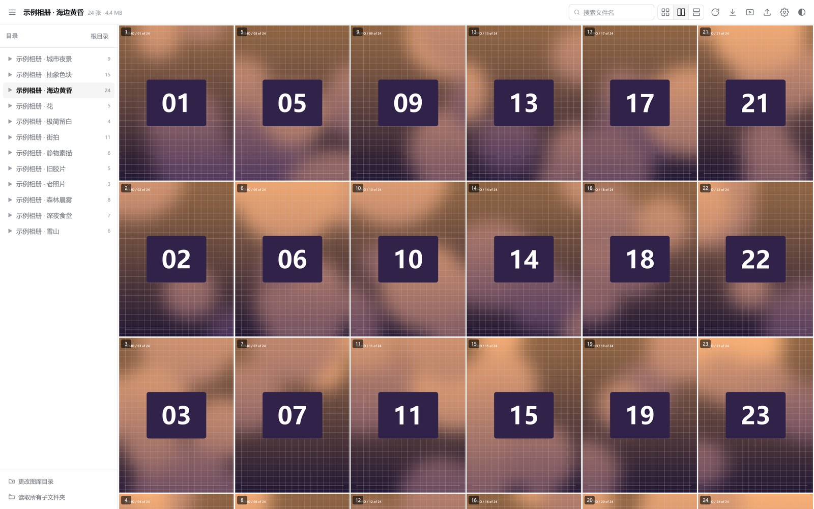
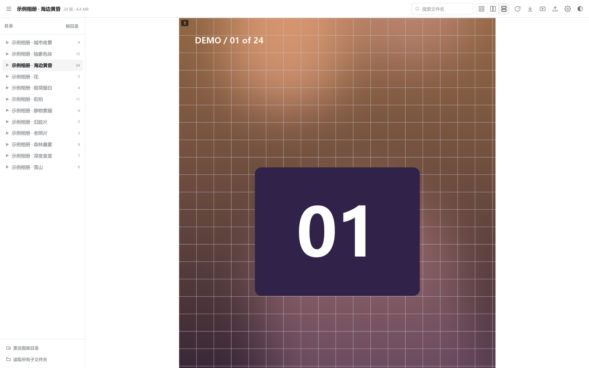
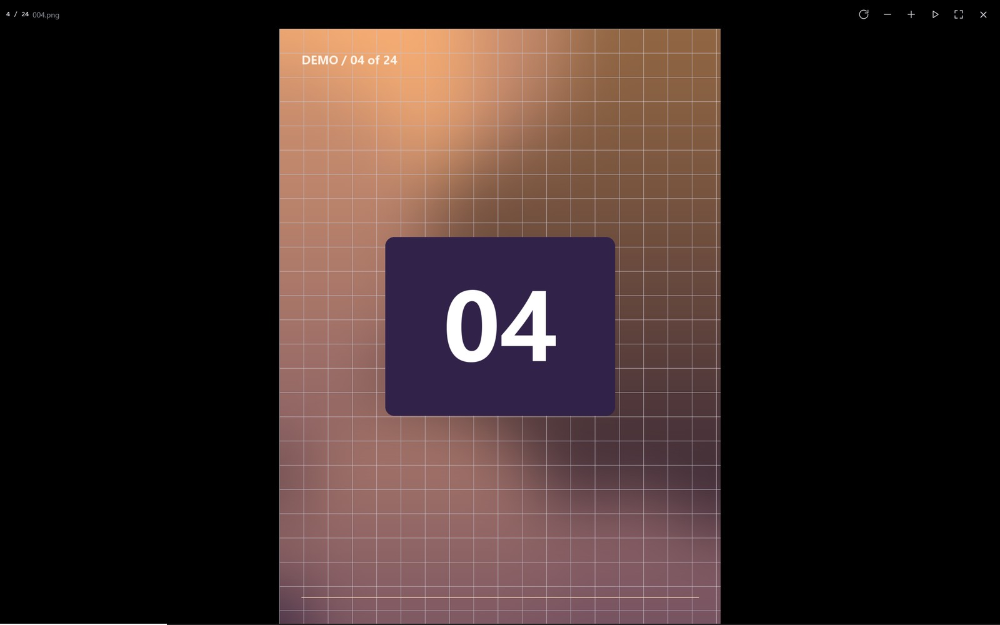
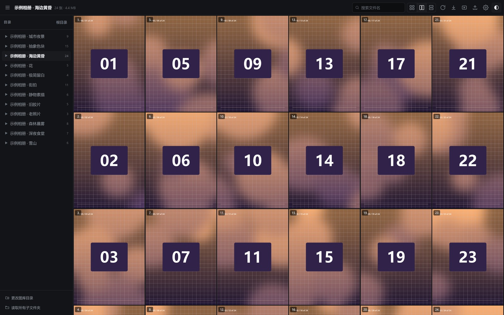
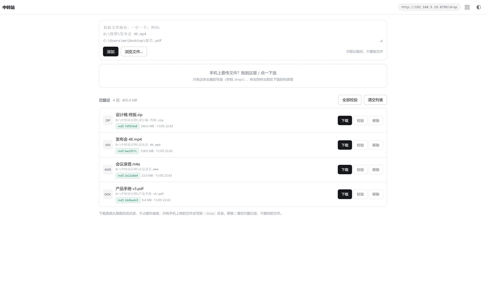
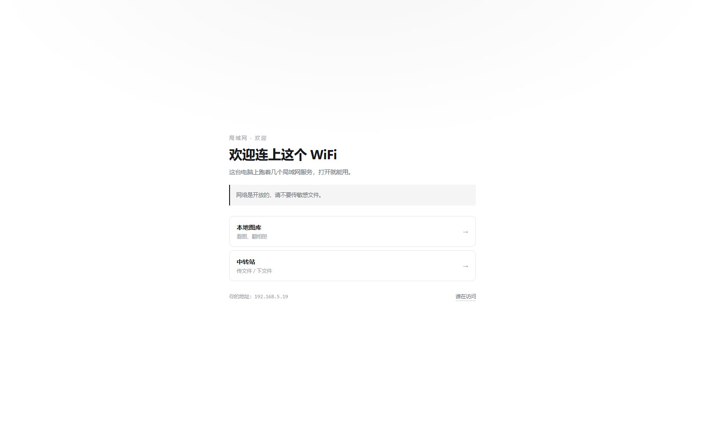
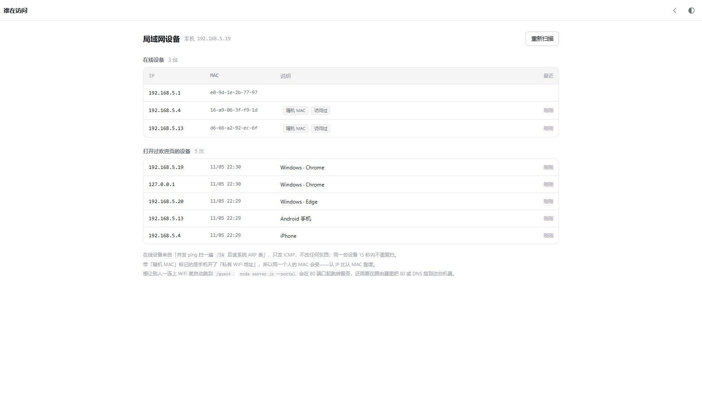

<div align="center">

# 本地图库

**零依赖的本地看图画廊。一个 Node 服务，电脑 / 手机 / 平板连同一个 WiFi 一起看。**

不用 npm install，不用构建，不联网，不上传。




</div>

---

## 它解决什么问题

手机拍的照片、下载的漫画、整理好的画集，散在电脑各个文件夹里。想看的时候要么开资源管理器一张张点，要么装个看图软件、导库、等扫描。

这个项目就干一件事：**把你电脑上的某个文件夹，变成一个网页。** 手机连同一个 WiFi，浏览器打开就能翻，翻完关掉。没有账号、没有数据库、没有后台进程。

- 一个 `server.js`，零依赖，`node server.js` 就跑
- 目录在网页里点一下就能换，记在 `config.json`，下次直接进
- 图片走 HTTP Range + 强缓存，第二遍打开基本零延迟
- 顺手带一个**局域网中转站**：电脑拖文件进去，手机打开地址就能下

---

## 快速开始

**1. 装 Node.js**（18 或更新，[nodejs.org](https://nodejs.org) 下 LTS 版就行）

**2. 双击 `start.bat`**（macOS / Linux 用 `node server.js`）

```
+---------------------------------------------
|  Local Gallery
+---------------------------------------------
|  Library : (not set)  -> pick it in the web page
|  Config  : ...\gallery\config.json
|  Drop    : ...\gallery\.drops
|  Local   : http://localhost:8710
|  LAN     : http://192.168.1.17:8710
+---------------------------------------------
```

**3. 打开 `http://localhost:8710`，点「选择图库目录」，挑一个放图片的文件夹**

搞定。手机 / 平板连同一个 WiFi，打开上面 `LAN` 那一行就行。

> 也可以把文件夹直接拖到 `start.bat` 上：`node server.js --root="D:\图片"`

---

## 截图

### 相册墙

进图库先看到文件夹封面墙，每个相册带张数和封面。


### 单列阅读

像在线漫画站那样一列到底，按原图比例无缝连排，0 间距，不裁不拉伸。高度在服务端就算好了，不会跳版。



### 灯箱

点任意图片进入。等比放到最大、完整可见，一边贴边一边留黑边。滚轮缩放、拖拽平移、双击放大 2.4×；手机像系统相册一样左右滑动翻页，两张图一起跟手走。



### 深色



### 中转站

电脑上把文件拖进去，同一 WiFi 的手机打开 `http://<你的IP>:8710/drop` 就能看到、能下。传完的文件直接躺在 `gallery/.drops` 里。



---

## 功能

### 三种浏览视图

| 视图 | 说明 | 快捷键 |
|---|---|---|
| 网格 `▦` | 列数 1–8 可调，适合快速扫一遍 | `1` |
| 多列 `▥` | 2–6 列，每列独立流动、图片首尾相接，不会因为行对齐出现空隙。**长按 ▥** 可切列数、调图片大小（60%–150%） | `3` |
| 单列 `▤` | 一列到底，按原图比例无缝连排，像漫画阅读器 | `2` |

四种填充方式（设置里改）：**原图比例**（默认，不裁不拉伸）、裁剪填满、完整显示、拉伸铺满。单列模式永远按原图比例。

### 旋转

`⟳` 或按 `R`：全局 0 → 90 → 180 → 270。旋转后格子按旋转后的真实比例重排，不变形、不裁切。灯箱里也能单独旋转当前这张。

### 自动滚动 / 幻灯片

- `⬇` 或 `空格` 开始 / 停止，到底自动停
- **长按**滚动键、播放键或 ▥ 弹出浮层，里面调滚动速度、滚动间隔、幻灯片间隔，改完立刻生效并自动保存
- 两种方式：**连续滚动**（10–400 px/s 匀速）或**按间隔跳**（每 N 秒翻一屏，1–60 秒可调）
- 播完一整册后：`循环本册` 或 `跳下一册`（只跳有图的相册）

### 中转站（局域网文件互传）

不需要装任何东西，不需要扫码，不需要注册。

1. 电脑打开图库，点顶栏的 **⤴** 进中转站
2. 把文件拖进虚线框（手机可以直接选照片 / 视频）
3. 另一台设备打开顶栏显示的那个地址（`http://192.168.x.x:8710/drop`），文件列表自动出现，点「下载」

细节：

- **断点续传**：4 MiB 分片，传一半断了、刷新页面、手机切后台挂起，回来接着传
- **同名不覆盖**：`报告.pdf` 已存在就自动存成 `报告 (1).pdf`
- **文件就在磁盘上**：默认 `gallery/.drops/`，用资源管理器直接能拿，改目录用 `--drop="D:\中转站"`
- **不做鉴权**：局域网内谁打开这个页面谁就能看、能下、能删。想清理就点「清空」
- **实时刷新**：SSE 推送，一台设备传完，另一台列表自动变
- 下载复用图库那套 Range / 206，几 GB 的蓝光原盘也不会把内存撑爆

### 访客门户（连上 WiFi 自动弹说明页）



`node server.js --portal` 会在 80 端口再起一个服务：**任何请求都 302 到 `/guest`**。
再配合路由器把 DNS 指到这台机器，别人连上 WiFi 后系统就会自己弹出「登录网络」——

| 系统 | 探测域名 |
|---|---|
| iOS / macOS | `captive.apple.com` |
| Android | `connectivitycheck.gstatic.com` |
| Windows | `www.msftconnecttest.com` |
| Firefox | `detectportal.firefox.com` |

`--dns` 会额外起一个 53 端口的 DNS：**只把这几个探测域名指回本机，其余全部透明转发**给上游（默认 `223.5.5.5`）。所以客人弹完提示后照常上网，不会变成酒店那种「不点确认就上不了网」。

一次性配置：

1. 路由器后台 → 局域网 / DHCP 设置 → **主 DNS 填这台电脑的 IP**，**备用 DNS 填 `223.5.5.5`**（这台电脑关机时兜底）
2. 在路由器里给这台电脑做 **IP 绑定**，否则 IP 一变 DNS 就指空了
3. `node server.js --portal --dns` 启动

> 中兴 / 华为这类运营商光猫的 DHCP 页面有时不给改 DNS。改不了就退回「把地址告诉客人」，或者换个能刷 OpenWrt 的路由器——`openNDS` / `nodogsplash` 是现成的。

**谁在访问**：`/guest/devices`



- 在线设备 = 并发 ping 扫一遍 `/24` 后读系统 ARP 表，只发 ICMP，3 秒出结果
- 手机开了「私有 WiFi 地址」的会标「随机 MAC」——认 IP 比认 MAC 靠谱
- 访问记录来自 `/guest` 的每一次真实请求（同 IP 30 秒内只记一次）

### 手机 / 平板

- `≤900px` 顶栏收成 ☰ + 标题 + 搜索 + 视图 + 全屏 + 设置；`≤760px` 出现底部操作栏（上一屏 / 旋转 / 滚动 / 下一屏）
- 网格按屏幕收敛列数（`≤480px` 最多 3 列，`≤760px` 最多 4 列）
- 搜索折叠成 🔍 浮层，目录选择器支持直接粘贴 Windows 路径
- 灯箱顶栏只留计数 / 旋转 / 播放 / 全屏 / 关闭

### 快捷键

| 键 | 作用 |
|---|---|
| `←` `→` | 灯箱上一张 / 下一张 |
| `空格` | 灯箱里开关幻灯片；页面里开关自动滚动 |
| `R` | 旋转 90° |
| `F` | 全屏 |
| `1` / `2` / `3` | 网格 / 单列 / 多列 |
| `-` / `=` | 减少 / 增加列数 |
| `M` | 收起或展开目录 |
| `Esc` | 关闭灯箱 / 设置 / 选择器 |

---

## 配置文件

位置：**`gallery/config.json`**，和 `server.js` 同级。首次保存时自动生成；仓库里只有 `config.example.json` 模板（本地配置已 gitignore，不会带你的路径进版本库）。

文件带中文注释（JSONC），服务端读的时候忽略注释，写的时候重新生成，注释不会丢。记事本存成带 BOM 的 UTF-8 也能读。

```jsonc
{
  // === 图库根目录 ==========================================
  "root": "",            // 留空 = 启动后在网页里选

  // ui = 界面与浏览的默认设置
  "ui": {
    "view": "grid",      // grid 网格 / two 多列 / single 单列
    "cols": 4,           // 网格列数 1-8
    "gap": 4,            // 图片间距 0-24 px
    "fit": "auto",       // auto / cover / contain / fill
    "theme": "light",    // light / dark
    "rot": 0,            // 初始旋转 0 / 90 / 180 / 270
    "autoSpeed": 90,     // 连续滚动速度 10-400 px/s
    "autoMode": "scroll",// scroll 连续 / step 按间隔
    "autoStep": 6,       // 按间隔跳的秒数 1-60
    "slideSec": 6,       // 幻灯片间隔 1-30
    "playMode": "loop",  // loop 循环本册 / next 跳下一册
    "twoH": 100,         // 多列图片缩放 60-150 %
    "twoCols": 2,        // 多列列数 2-6
    "recursive": false,  // 默认读取所有子文件夹
    "showIndex": true,   // 图片上显示序号
    "sort": "name"
  }
}
```

**任何设置改动都会自动保存**（防抖 250ms），滑块松手立刻存一次，页面隐藏 / 关闭时用 `keepalive` 补发一次。每次保存服务端会打印 `[gallery] 已保存配置 -> ...`，可以确认到底写没写进去。

---

## 命令行

```bash
node server.js                       # 默认 8710
node server.js --port=8711           # 换端口
node server.js --root="D:\图片"      # 直接指定图库目录
node server.js --drop="D:\中转站"    # 换中转站存放目录
node server.js --portal              # 80 端口起门户跳转
node server.js --dns                 # 53 端口劫持联网探测域名
node server.js --dns-upstream=8.8.8.8  # 换 DNS 上游
node server.js --no-open             # 不自动开浏览器
node server.js --no-kill             # 端口被占时不自动清理
```

`start.bat` 会先 `netstat` 找到占用 8710 的进程并 `taskkill`，再启动服务；`stop.bat` 单独释放端口。

---

## 接口

| 路径 | 说明 |
|---|---|
| `GET /api/info` | 根目录、端口、局域网地址、配置路径 |
| `GET /api/config` | 读取配置 |
| `POST /api/config` | 保存配置 `{ root?, ui? }` |
| `GET /api/drives` | 盘符 + 常用位置 |
| `GET /api/browse?p=DIR` | 列任意目录的子文件夹（目录选择器用） |
| `GET /api/list?p=REL` | 图库内的内容；`&recursive=1` 递归 |
| `GET /img?p=REL` | 图片字节，支持 Range / ETag / 强缓存 |
| `GET /api/drop/list` | 中转站文件列表 |
| `GET /api/drop/upload?name=X&size=N` | 查询已收字节（断点续传） |
| `PUT /api/drop/upload?name=X` | 分片上传，需 `Content-Range: bytes a-b/total` |
| `GET /api/drop/events` | SSE，列表变化实时推送 |
| `GET /d/:name` | 下载中转站文件（`Content-Disposition: attachment`） |
| `DELETE /api/drop/file?name=X` · `/api/drop/all` | 删除单个 / 清空 |
| `GET /guest` | 访客门户（会记一条访问日志） |
| `GET /guest.json` | 门户文案（改 `guest.json` 生效） |
| `GET /guest/devices` | 设备看板页面 |
| `GET /api/guest/devices` | 在线设备 + 访问记录；`?scan=1` 强制重扫 |

**安全边界**：`/api/list` 和 `/img` 只能访问 `root` 以内的路径，`..`、绝对路径、盘符一律 403；服务端不提供写入 / 删除图库的接口。中转站是有意设计成无鉴权的——它只该在你自己信任的局域网里跑。

---

## 性能

- 服务端只读文件头解析宽高比（WebP / JPEG / PNG / GIF / BMP），网格先占位再填图，不跳版
- 图片 `Cache-Control: immutable`，第二遍打开基本零延迟
- 懒加载用几何扫描（视口 ±2.5 屏）+ rAF 节流，不依赖 `IntersectionObserver`；连续 4 轮没有新图可加载就自动停，滚动再唤醒
- 递归模式单次上限 20000 张、8 层深，超出会提示
- 上传用 `req.pipe(createWriteStream)` 直接落盘，不经过内存缓冲

**上万张图**建议别开递归，按文件夹分开看——一次渲染几千个节点是浏览器极限。

---

## 目录结构

```
gallery/
├── server.js           服务端（零依赖，单文件）
├── start.bat           双击启动（纯 ASCII，不会有乱码）
├── stop.bat            释放端口
├── config.example.json 配置模板
├── guest.example.json  门户文案模板
├── config.json         本地配置，首次保存时生成（已 gitignore）
├── guest.json          本地门户文案（已 gitignore）
├── .guest-log.json     访问记录（已 gitignore）
├── .drops/             中转站收到的文件（已 gitignore）
├── public/
│   ├── index.html      图库页面
│   ├── app.js          前端逻辑
│   ├── style.css
│   ├── drop.html       中转站页面
│   ├── guest.html      访客门户
│   └── devices.html    设备看板
├── docs/
│   ├── img/            README 截图
│   └── 中转站-调研与集成方案.md
└── README.md
```

---

## 常见问题

**启动脚本乱码 / 报「不是内部或外部命令」**
两个 bat 都是纯 ASCII，旧版里带中文会读错行，直接覆盖即可。

**端口 8710 被占用**
已内置自动清理。若被其它程序反复抢占，用 `node server.js --port=8711`。

**手机连不上**
检查 Windows 防火墙有没有放行 Node.js 的入站连接：

```bat
netsh advfirewall firewall add rule name="Gallery 8710" dir=in action=allow protocol=TCP localport=8710
```

**页面空白 / 一直转圈**
看命令行窗口有没有报错，浏览器 F12 看 Console。多数是 `config.json` 里的 `root` 路径已不存在，重新选一次目录即可。

**配置读不出来**
服务端会明确报错并保留原文件，不再静默清空。点空状态里的「重新选择图库目录」即可覆盖修复。

**多列模式只剩一列**
v1.1 已修（`column-fill: auto` 在容器高度不受限时会把全部内容塞进第一列）。升级到最新版即可。

**中转站传大文件卡住**
v1.2 起服务端已设 `requestTimeout = 0`，慢网络也不会被 5 分钟掐断。iOS Safari 单文件超过 ~512MB 是浏览器本身的限制，换电脑下载。

---

## 更新日志

### v1.3 · 2026-11-05

- 新增**访客门户**：`--portal` 在 80 端口把任何请求 302 到 `/guest`；`--dns` 劫持 4 个联网探测域名（其余透明转发），别人连上 WiFi 自动弹出说明页
- 新增**设备看板** `/guest/devices`：并发 ping 扫 `/24` + 读 ARP 表列出在线设备，并记录每次打开门户的 IP / 浏览器 / 时间
- 门户跳转改用 `req.socket.localAddress`，多网卡（热点 / VPN）时不再把客人送到连不上的地址
- `lanAddresses()` 把 `192.168.137.1`（Windows 移动热点固定地址）排到最后

### v1.2 · 2026-11-05

- 新增**局域网中转站**：拖文件进去，同一 WiFi 的设备打开 `/drop` 就能下载；分片上传 + 断点续传 + SSE 实时列表 + 同名不覆盖
- 图库顶栏新增 ⤴ 入口
- `lanAddresses()` 优先返回私网地址（192.168 / 10 / 172.16-31），VPN 虚拟网卡不再抢第一行

### v1.1 · 2026-11-05

修掉一批影响日常使用的问题：

| 位置 | 问题 |
|---|---|
| 多列模式 | **只剩左边一列**：`column-fill: auto` 在容器高度不受限时会把全部内容塞进第一列 |
| 旋转 | 180° 完全不生效（只有 90/270 走了旋转分支） |
| 列数 | 配置里存的 `cols` 被视口自适应覆盖，重开就变回默认 |
| 自动滚动 | 「按间隔跳」被兜底逻辑掐掉平滑滚动，每轮只挪几像素 |
| 根目录 | 空目录自动钻进最大子相册，相册墙永远看不到、URL 也不同步 |
| 搜索 | 搜索词跨目录残留，进新相册直接「没有匹配的图片」 |
| 灯箱 | 触屏滑动翻页后 `rotate` 丢失导致图片被拉伸 |
| 懒加载 | 扫描轮询永不停止，图多时每 600ms 全量 `getBoundingClientRect` |
| 快捷键 | 切视图 / 改列数不落盘；空格键与按钮焦点互相抵消；`F` 在 iOS 上抛 `TypeError` |
| 手机底栏 | 上一屏 / 下一屏两个按钮没有任何绑定 |
| 目录选择器 | 手打 / 粘贴的路径被覆盖，点「使用此文件夹」装的是上次浏览的目录 |
| `config.json` | 带 BOM 或写坏时静默清空 `root` |
| `/img` | 206 分支的读流没挂 `error` 监听，读失败会让整个进程退出 |
| 列表缓存 | 只看目录 mtime，原地替换图片后大小 / 宽高一直是旧值 |
| `start.bat` | 拖文件夹进来时尾反斜杠让 `--root` 的引号被转义，目录被静默忽略 |

新增：**灯箱顶栏全屏按钮 ⛶**（与 `F` 键、顶栏 ⛶ 同一套逻辑）。

---

## 许可

MIT
